## 0. Версии инструментов

```text
docker --version && docker compose version
Docker version 24.0.5, build ced0996
Docker Compose version v5.5.1

uname -a
Linux ubuntu-nginx 5.15.0-198-generic #208-Ubuntu SMP Fri Sep 4 10:22:38 UTC 2026 x86_64 x86_64 GNU/Linux
```

## 1. Запуск и готовность стека

```text
docker compose ps
NAME                      IMAGE                 COMMAND                  SERVICE   STATUS                    PORTS
student-compose-app-1     student-compose-app   "flask --app app run…"   app       Up 10 seconds             8000/tcp
student-compose-cache-1   redis:8.8-alpine      "docker-entrypoint.s…"   cache     Up 16 seconds (healthy)   6379/tcp
student-compose-db-1      postgres:18           "docker-entrypoint.s…"   db        Up 16 seconds (healthy)   5432/tcp
student-compose-web-1     nginx:1.30-alpine     "/docker-entrypoint.…"   web       Up 9 seconds              0.0.0.0:18090->80/tcp, [::]:18090->80/tcp
```

*Запросы к приложению: счётчик растёт, контрольная заметка записана и читается:*

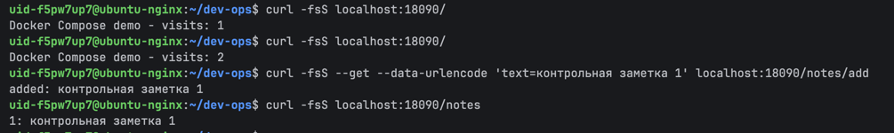

## 2. Том БД и замена контейнера

```text
docker compose exec db sh -c 'psql -U "$POSTGRES_USER" -d "$POSTGRES_DB" -tc "SHOW data_directory;"'
 /var/lib/postgresql/18/docker
```

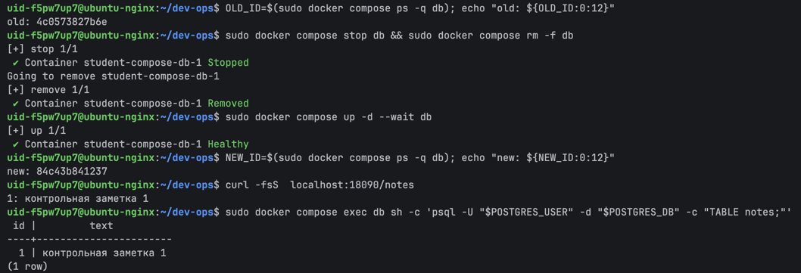

*Контейнер БД остановлен и удалён, затем поднят заново: id контейнеров разные, а заметка на месте - состояние живёт в именованном томе `student-compose_pgdata`.*

## 3. Что сохраняем, что допускаем потерять

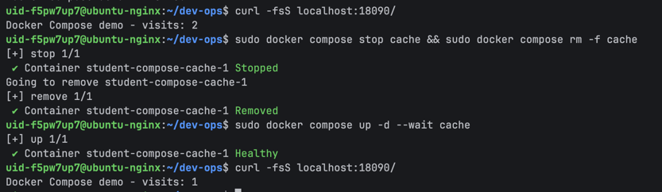

*Сохраняем: заметки в PostgreSQL. Допускаем потерю счётчика `visits` (cache) это метрика, а не критичные данные.*

## 4. Холодный бэкап

*Остановка всех писателей и БД, том сохранён в архив временным контейнером `postgres:18` в каталог `backup/` вне volume:*

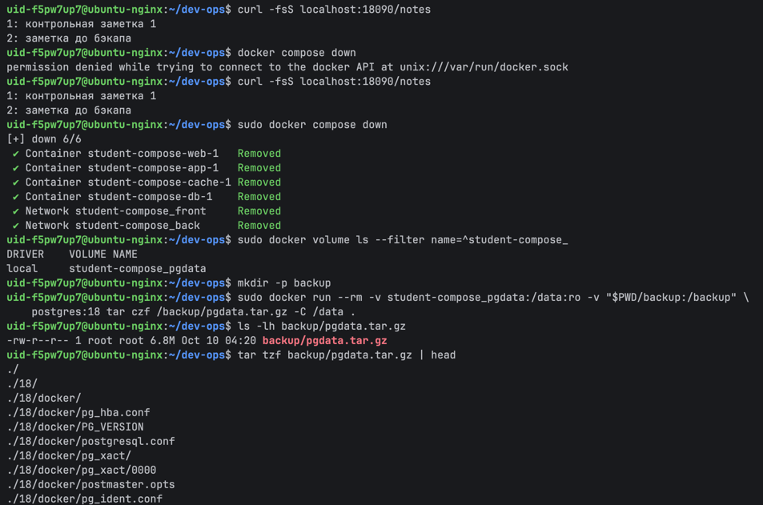

*Восстановили том из архива*

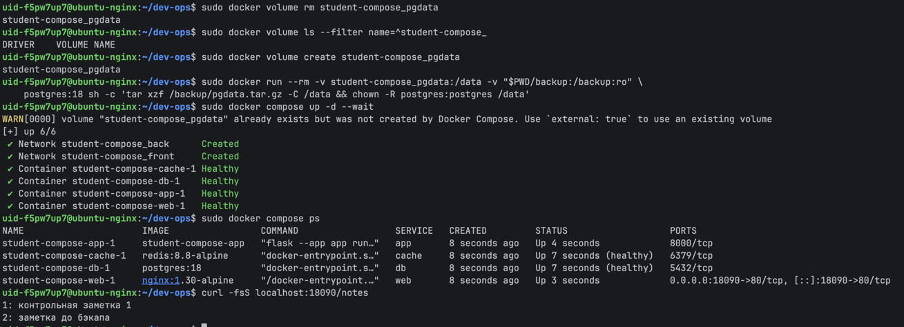

## 5. Сети: front и back

*Только web отдает порт наружу*

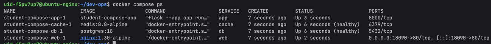

*Разделение на back и front*

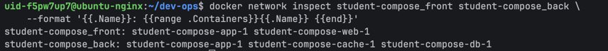

*Отсутствие db в web и отказ tcp подключения*

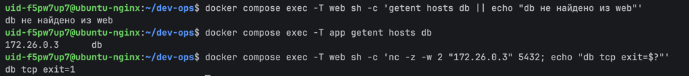

*Доступ из app до cache и db (вообще доступ подтверждается тем что в приложении работает запись заметок и счетчик*

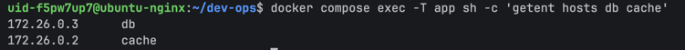

## 6 Конфиг

```yaml
name: student-compose
services:
  app:
    build:
      context: /home/uid-f5pw7up7/dev-ops
      dockerfile: Dockerfile
    develop:
      watch:
        - path: /home/uid-f5pw7up7/dev-ops/Dockerfile
          action: rebuild
    command:
      - flask
      - --app
      - app
      - run
      - --debug
      - --host=0.0.0.0
      - --port=8000
    depends_on:
      cache:
        condition: service_healthy
        required: true
      db:
        condition: service_healthy
        required: true
    environment:
      DB_HOST: db
      FLASK_DEBUG: "1"
      POSTGRES_DB: compose_demo
      POSTGRES_PASSWORD: <секрет>
      POSTGRES_USER: compose_user
      REDIS_HOST: cache
    mem_limit: "268435456"
    networks:
      back: null
      front: null
    restart: unless-stopped
    volumes:
      - type: bind
        source: /home/uid-f5pw7up7/dev-ops/app
        target: /app
        read_only: true
        bind: {}
  cache:
    healthcheck:
      test:
        - CMD
        - redis-cli
        - ping
      timeout: 2s
      interval: 2s
      retries: 15
    image: redis:8.8-alpine
    networks:
      back: null
    restart: unless-stopped
  db:
    environment:
      POSTGRES_DB: compose_demo
      POSTGRES_PASSWORD: <секрет>
      POSTGRES_USER: compose_user
    healthcheck:
      test:
        - CMD-SHELL
        - pg_isready -U $$POSTGRES_USER -d $$POSTGRES_DB
      timeout: 2s
      interval: 2s
      retries: 15
      start_period: 3s
    image: postgres:18
    networks:
      back: null
    restart: unless-stopped
    volumes:
      - type: volume
        source: pgdata
        target: /var/lib/postgresql
        volume: {}
  web:
    depends_on:
      app:
        condition: service_started
        required: true
    image: nginx:1.30-alpine
    networks:
      front: null
    ports:
      - mode: ingress
        target: 80
        published: "18090"
        protocol: tcp
    restart: unless-stopped
    volumes:
      - type: bind
        source: /home/uid-f5pw7up7/dev-ops/nginx/default.conf
        target: /etc/nginx/conf.d/default.conf
        read_only: true
        bind: {}
networks:
  back:
    name: student-compose_back
  front:
    name: student-compose_front
volumes:
  pgdata:
    name: student-compose_pgdata
```

Имя из name:, имена контейнеров из name: + имя сервиса в compose

*`down -v` удаляет и том, томов проекта не остаётся. При следующем `up` база инициализируется заново:*

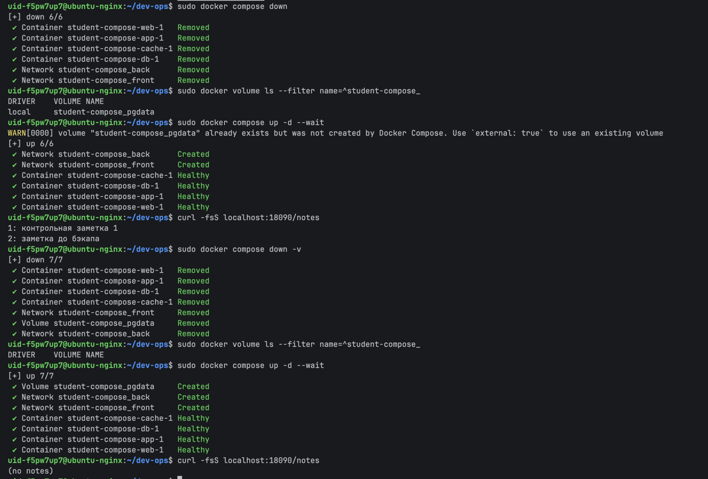

## 7 dive

Версии
docker --version && docker compose version && dive --version
Docker version 29.7.2, build a7dcaa6
Docker Compose version v5.3.1
dive 0.13.1

Было

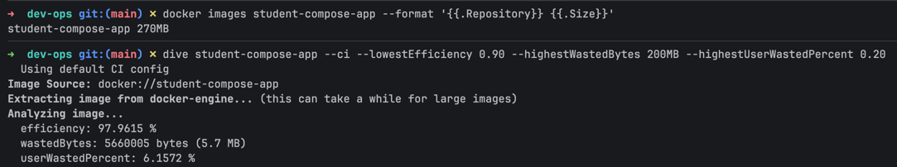

```dockerfile
FROM python:3.14-slim

RUN useradd --create-home --uid 10001 appuser
WORKDIR /app

COPY app/requirements.txt ./requirements.txt
RUN pip install --no-cache-dir -r requirements.txt

COPY --chown=appuser:appuser app/ .
USER appuser

EXPOSE 8000
CMD ["python", "app.py"]

```


Стало

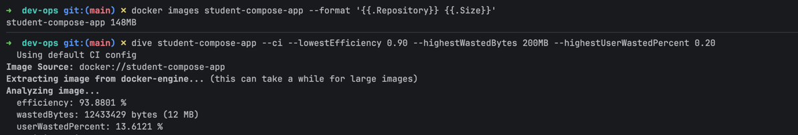

```dockerfile
FROM python:3.14-alpine AS builder

RUN apk add --no-cache gcc musl-dev postgresql-dev

WORKDIR /wheels
COPY app/requirements.txt .
RUN pip wheel --no-cache-dir --wheel-dir /wheels -r requirements.txt

FROM python:3.14-alpine

RUN apk add --no-cache postgresql-libs \
 && adduser -D -u 10001 appuser

WORKDIR /app
COPY --from=builder /wheels /wheels
RUN pip install --no-cache-dir --no-index --find-links=/wheels -r /wheels/requirements.txt \
 && rm -rf /wheels

COPY --chown=appuser:appuser app/ .
USER appuser

EXPOSE 8000
CMD ["python", "app.py"]

```
